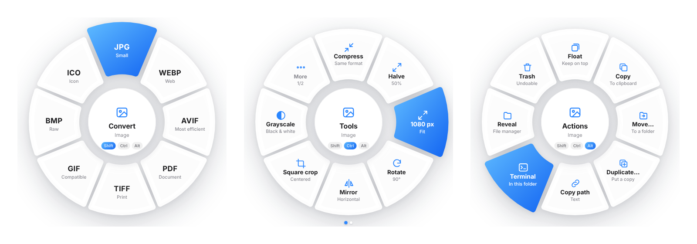
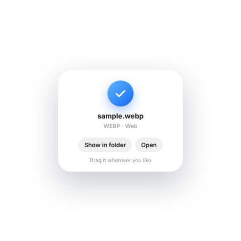

# ShiftDrop

A [Tangerine](https://tangerineformac.com/)-style file converter for Linux and Windows. Start dragging a file and tap a key: a wheel opens around your cursor, and you drop the file onto the slice you want. Everything runs on your computer, and no file is ever uploaded anywhere.

| Tap while dragging | Wheel | Examples |
|---|---|---|
| **Shift** | Convert | PNG, JPG, WebP, AVIF, PDF, MP4, WebM, GIF, MP3, DOCX, XLSX… |
| **Ctrl** | Tools | Compress, halve, rotate, square crop, mute, 2× speed, split, merge, ZIP |
| **Alt** | Actions | Float, copy to clipboard, move, duplicate, copy path, terminal, reveal, move to trash |



You don't need to hold the key. Tap it and the wheel stays open until you drop the file or press **Esc**. While the wheel is open, tap another key to switch wheels. Dropping on the centre cancels. When there are more than eight options, hover over the **More** slice for a moment or turn the mouse wheel.

When a job finishes, a result card appears in the middle of the wheel. You can drag the card straight into another window, or click **Show in folder** or **Open**. Output is always written next to the source file and never overwrites anything (e.g. `photo (1).webp`).

<p align="center"></p>

> The interface is available in English and Turkish. It follows your system language by default, and you can switch it from the tray menu (**Language**).

## Installation

Ready-made installers are on the [Releases](https://github.com/kaptanoguz/ShiftDrop/releases) page. On every push to `main`, GitHub Actions rebuilds them and publishes them under the version number in `package.json`.

### Windows

Each build comes in English and Turkish. The language only sets the default; both builds contain both languages.

| | English | Türkçe |
|---|---|---|
| Installer | `ShiftDrop-Setup-<version>.exe` | `ShiftDrop-Kurulum-<version>.exe` |
| Portable | `ShiftDrop-Portable-<version>.exe` | `ShiftDrop-Tasinabilir-<version>.exe` |
| Linux | `ShiftDrop-<version>-EN.AppImage` | `ShiftDrop-<version>-TR.AppImage` |

The installer creates desktop and Start menu shortcuts and doesn't need admin rights. The portable version needs no installation; double-click to run.

The app is unsigned, so SmartScreen may show "Windows protected your PC" the first time you open it. Click **More info → Run anyway**. ShiftDrop runs in the notification area on the right side of the taskbar, and its menu is there.

### Linux (AppImage)

```bash
chmod +x ShiftDrop-*-EN.AppImage
./ShiftDrop-*-EN.AppImage
```

### From source

Requires Node.js 20 or newer.

```bash
git clone https://github.com/kaptanoguz/ShiftDrop.git && cd ShiftDrop
npm install
npm start          # run the app
npm test           # test the conversion engine without Electron
npm run dist:linux:en  # build an English AppImage into dist/ (dist:linux for Turkish)
npm run dist:win:en    # build the English Windows installer and portable exe (dist:win for Turkish; needs wine on Linux)
```

### Optional system tools

Image, video, audio, subtitle and ZIP jobs work out of the box, because ffmpeg ships with the app. The jobs below are enabled when these tools are installed.

On Windows, a normal install of [LibreOffice](https://www.libreoffice.org/download/) and [7-Zip](https://www.7-zip.org/) is enough. For poppler and Ghostscript, add their `bin` folders to PATH. On Linux:

```bash
sudo apt install libreoffice poppler-utils ghostscript p7zip-full
```

- **LibreOffice**: Word, ODT, RTF, EPUB, presentation and spreadsheet conversions, and PDF to DOCX
- **poppler-utils**: PDF to 300 DPI PNG/JPG and text, and the cover page
- **ghostscript**: PDF compression
- **p7zip**: Extracting RAR and 7z

## Windows

Keys pressed while dragging are detected system-wide, with no extra permissions. Shift, Ctrl and Alt change Explorer's drop behaviour, but ShiftDrop always takes the file as a copy and never touches the source. The **Copy** action puts files on the clipboard so you can paste them in Explorer with Ctrl+V. **Terminal** opens Windows Terminal if it's installed. You can turn on **Start at login** from the tray menu.

## X11 and Wayland

- **X11**: Keys pressed while dragging are detected system-wide, and the wheel opens at your cursor.
- **Wayland**: For security, Wayland doesn't let apps listen to keys pressed in other apps. To work around this, a small **drop bubble** sits on the right edge of the screen. Drag a file onto the bubble and the wheel opens there. Shift, Ctrl and Alt still work once the wheel is open, because the cursor is now over ShiftDrop. You can drag the bubble up and down along the edge.

On X11 you can also turn the bubble on from the tray menu. The tray menu also lets you change key bindings and start the app at login. Fallback shortcut: **Ctrl+Alt+Space** opens the wheel under the cursor. Drop a file onto it, then click a slice.

## Known limitations

- On Wayland the app runs through XWayland, because that's the only way to position a window next to the cursor.
- No HEIC encoding (decoding depends on system libraries). Pages and Keynote files aren't supported.
- Tools that need settings, such as choosing a crop or trim range, aren't available. **Split** cuts a file in half.

## Project structure

```
src/main.js         Main process: global key hooks, windows, tray, file actions
src/i18n.js         English translations (the source strings are Turkish)
src/engine.js       Conversion and tools engine (independent of Electron)
src/preload.js      Bridge between the UI and the main process
src/renderer/       Wheel, edge bubble and floating file window
scripts/            Build, smoke test and screenshot scripts
```
